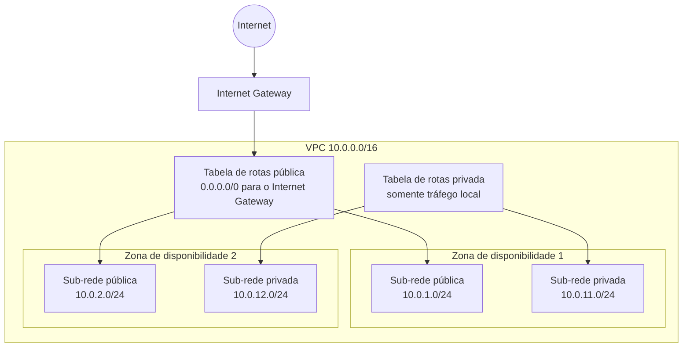
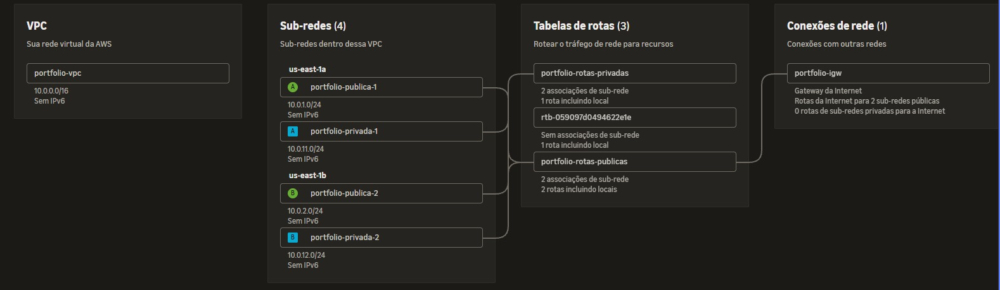
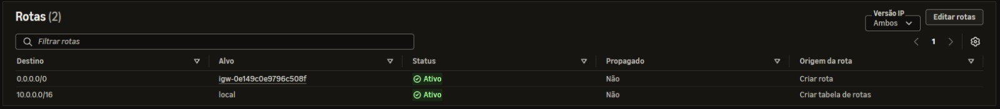
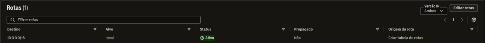
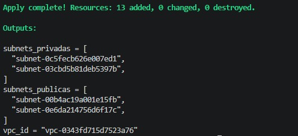

# VPC na AWS com Terraform

Rede AWS (VPC) com sub-redes públicas e privadas em duas zonas de disponibilidade, provisionada 100% com Terraform.

## Resumo em 30 segundos

Neste projeto construí, por código, uma **rede privada na nuvem da AWS**, o equivalente ao cabeamento e à segurança de um escritório, só que virtual. A rede é dividida em áreas **públicas** (acessíveis pela internet) e **privadas** (isoladas), em dois data centers diferentes para ter redundância. Tudo é criado e removido com poucos comandos e **sem custo**.

## Arquitetura



## Plano de endereços

| Recurso | CIDR | Zona | Função |
|---|---|---|---|
| VPC | `10.0.0.0/16` | - | Rede completa (cerca de 65 mil IPs) |
| Pública 1 | `10.0.1.0/24` | AZ 1 | Recursos acessíveis pela internet |
| Pública 2 | `10.0.2.0/24` | AZ 2 | Idem, em outra zona |
| Privada 1 | `10.0.11.0/24` | AZ 1 | Recursos protegidos |
| Privada 2 | `10.0.12.0/24` | AZ 2 | Idem, em outra zona |

A numeração segue uma convenção: as sub-redes públicas usam as faixas `10.0.1.x` e `10.0.2.x`, e as privadas usam `10.0.11.x` e `10.0.12.x`. Assim, só pelo IP já dá para saber o tipo da sub-rede.

## Decisões de projeto

- **Duas zonas de disponibilidade:** se um data center falhar, a outra zona continua operando.
- **Pública x privada pela tabela de rotas:** a sub-rede é pública porque sua tabela tem a rota `0.0.0.0/0` para o Internet Gateway. A privada não tem essa rota e não alcança a internet.
- **Sem NAT Gateway:** ele é cobrado por hora. Para demonstrar o conceito, mantive as sub-redes privadas isoladas. Em um ambiente real, um NAT permitiria que elas baixassem atualizações.
- **Security group sem SSH:** só HTTP (80) e HTTPS (443) de entrada. Abrir a porta 22 para a internet é um erro comum de segurança, então foi omitida de propósito.
- **`count` e `locals` no Terraform:** reduzem repetição e deixam os nomes e faixas de IP em um lugar só.

## Evidências

**1. Rede criada na AWS (Resource map da VPC):**



**2. Tabela de rotas pública: possui a rota para o Internet Gateway (`0.0.0.0/0`):**



**3. Tabela de rotas privada: somente tráfego local, sem saída para a internet:**



**4. Execução do Terraform:**



Saída em texto:

```text
Apply complete! Resources: 13 added, 0 changed, 0 destroyed.

Outputs:

subnets_privadas = [
  "subnet-0c5fecb626e007ed1",
  "subnet-03cbd5b81deb5397b",
]
subnets_publicas = [
  "subnet-00b4ac19a001e15fb",
  "subnet-0e6da214756d6f17c",
]
vpc_id = "vpc-0343fd715d7523a76"

## Tecnologias

- AWS: VPC, sub-redes, Internet Gateway, tabelas de rotas, security groups
- Terraform (provider `aws`)
- Git e GitHub

## Como reproduzir

Pré-requisitos: conta AWS, AWS CLI e Terraform instalados, e um usuário IAM configurado no CLI.

```bash
git clone https://github.com/coutolucasdev/aws-vpc-terraform.git
cd aws-vpc-terraform

# Confirme a conta antes de criar recursos
aws sts get-caller-identity

terraform init
terraform plan
terraform apply
```

## Custo

Todos os recursos deste projeto (VPC, sub-redes, Internet Gateway, tabelas de rotas e security group) não geram cobrança. Não há NAT Gateway nem instâncias EC2. Mesmo assim, removo o ambiente ao terminar.

## Como remover tudo

```bash
terraform destroy
```

## O que aprendi

Neste projeto aprendi que a diferença entre uma sub-rede pública e uma privada está na tabela de rotas: a pública tem a rota `0.0.0.0/0` para o Internet Gateway, e a privada não tem. Também aprendi a planejar os endereços (CIDR) antes de escrever o código e a distribuir a rede em duas zonas de disponibilidade para ter redundância. Pelo caminho, resolvi problemas de conta e de credenciais, e reforcei o hábito de confirmar a conta com `aws sts get-caller-identity` antes de cada `apply` e de documentar tudo com evidências.

## Próximos passos

- Servidor web (EC2) na sub-rede pública
- Monitoramento com CloudWatch

## Autor

Lucas Couto | AWS Certified Cloud Practitioner
[LinkedIn](https://www.linkedin.com/in/lucascoutoaraujo)